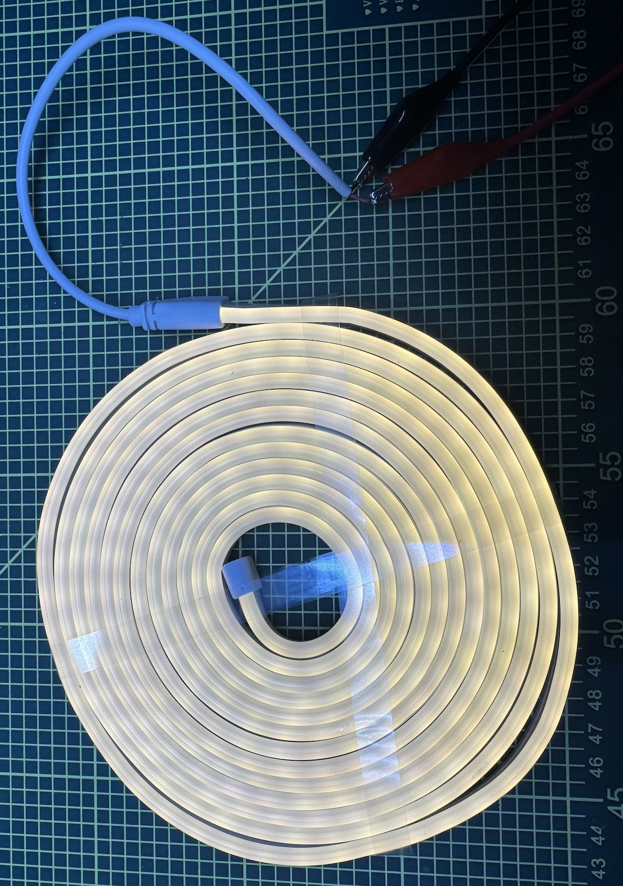
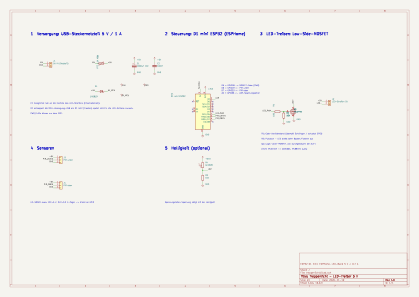

# Treppenlicht

Automatisches Treppenlicht mit einem 5-V-LED-Band, gesteuert von einem
**D1 mini ESP32** mit **ESPHome**. Zwei PIR-Bewegungsmelder (unten und oben an
der Treppe) schalten das Licht sanft ein; nach der Nachlaufzeit wird es
weich ausgeblendet. Optional schaltet ein Helligkeitssensor (LDR) nur bei Dunkelheit.
Die Einbindung in Home Assistant erfolgt über die ESPHome-API.



## Funktionen

- Einschalten per Bewegung (unten *oder* oben), Fade-in 1 s, Fade-out 3 s
- Licht bleibt an, solange ein Melder Bewegung sieht, danach einstellbare Nachlaufzeit
- Helligkeit stufenlos per PWM (2 kHz), standardmäßig auf 80 % begrenzt (Strombudget)
- „Nur bei Dunkelheit“ mit LDR und einstellbarer Schwelle (mit Hysterese)
- Einstellungen zur Laufzeit änderbar und gespeichert: Automatik, Max. Helligkeit,
  Nachlaufzeit, Dunkel-Schwelle
- Manuelles Ein/Aus über Home Assistant bleibt möglich und wird von der Automatik nicht überschrieben
- OTA-Updates, verschlüsselte API, WLAN-Fallback-Hotspot

## Projektstruktur

```
hardware/   KiCad-10-Schaltplan, PDF-Export, Stückliste
software/   ESPHome-Konfiguration
docs/       Fotos, Schaltplan als SVG
```

## Hardware

Schaltplan: [`hardware/treppenlicht.kicad_sch`](hardware/treppenlicht.kicad_sch)
(KiCad 10), PDF: [`hardware/treppenlicht-schaltplan.pdf`](hardware/treppenlicht-schaltplan.pdf),
Stückliste: [`hardware/BOM.md`](hardware/BOM.md).



Aufbau in Kürze:

- **Versorgung:** USB-Netzteil 5 V/1 A → Klemme J1 → PTC-Sicherung F1 → Schiene +5 V
  (C1 1000 µF und C2 100 nF puffern).
- **LED-Treiber:** Low-Side-Schaltung. Der Pluspol des Bandes liegt an +5 V, der
  Minuspol am Drain des Logic-Level-MOSFET Q1 (IRLZ44N), Source an GND. Das Gate
  hängt über 100 Ω an GPIO18, ein 10-kΩ-Pulldown hält die LED beim Booten aus.
  Der MOSFET wird bei 3,3 V Gate-Spannung voll durchgesteuert.
- **MCU:** Der D1 mini wird über den 5-V-Pin und die Schottky-Diode D1 versorgt.
  So kann man ihn am USB-Port flashen, ohne in die LED-Schiene zurückzuspeisen.
- **Sensoren:** PIR-Melder (5 V, 3,3-V-Ausgang) an GPIO19 und GPIO23; LDR-Teiler an GPIO36.

| Funktion | D1-mini-Pin | GPIO |
|----------|-------------|------|
| MOSFET-Gate (PWM) | D5 | 18 |
| PIR unten | D6 | 19 |
| PIR oben | D7 | 23 |
| LDR (ADC) | A0 | 36 |

> **Hinweise**
> - Die Pin-Beschriftung (D5, D6, …) der D1-mini-ESP32-Klone ist nicht einheitlich.
>   Maßgeblich sind die GPIO-Nummern; bei abweichender Belegung `pin_*` in der YAML anpassen.
> - Strombudget: LED < 0,7 A + ESP32 + PIR ≈ 1 A. Deshalb Standard-Helligkeit 80 %, siehe [BOM.md](hardware/BOM.md).
> - Die Schaltung läuft nur mit 5 V aus dem Netzteil. Keine Netzspannung im Aufbau.
> - Der Schaltplan wurde mit KiCad 10 erstellt und per ERC geprüft (0 Fehler, 0 Warnungen).
>   Eine Platine (PCB) gibt es nicht; der Aufbau ist für Lochraster gedacht.
> - Bei einem **adressierbaren** Band (WS2812B) passt diese Schaltung nicht – dort wird
>   ein Level-Shifter (74AHCT125) statt des MOSFETs benötigt.

## Software

1. ESPHome installieren (`pip install esphome` oder Home-Assistant-Add-on).
2. Zugangsdaten anlegen:
   ```bash
   cd software
   cp secrets.yaml.example secrets.yaml
   # Werte eintragen; API-Key erzeugen mit: openssl rand -base64 32
   ```
3. Erstes Flashen per USB, danach OTA:
   ```bash
   esphome run treppenlicht.yaml
   ```
4. In Home Assistant erscheint das Gerät automatisch (ESPHome-Integration).

### Entitäten

| Entität | Typ | Beschreibung |
|---------|-----|--------------|
| Licht | light | LED-Band, dimmbar |
| Bewegung unten / oben | binary_sensor | PIR-Zustände |
| Dunkel | binary_sensor | aus LDR abgeleitet |
| Helligkeit (LDR-Spannung) | sensor | Rohwert zum Einstellen der Schwelle |
| Automatik | switch | Bewegungssteuerung an/aus |
| Nur bei Dunkelheit | switch | Auslösen nur wenn „Dunkel“ (LDR nötig) |
| Max. Helligkeit | number | 5–100 %, Standard 80 % |
| Nachlaufzeit | number | 5–600 s, Standard 30 s |
| Dunkel-Schwelle | number | LDR-Spannung in V, Standard 1,5 V |

Ohne LDR bleibt „Nur bei Dunkelheit“ ausgeschaltet.

### Ablauf

```
PIR löst aus ─► Automatik an? ─► (Dunkel oder Dunkelheitsprüfung aus?) ─► Licht an (Fade 1 s)
      ▲                                                                    │
      └── erneute Bewegung startet den Ablauf neu    beide PIR frei ◄──────┘
                                                      │
                                         Nachlaufzeit ─► Licht aus (Fade 3 s)
```

## Lizenz

Noch nicht festgelegt.
